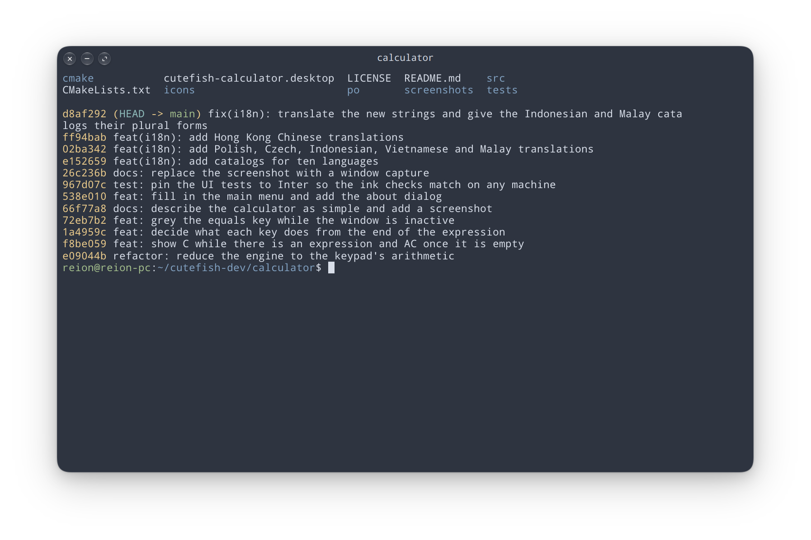

# CutefishOS Terminal

A terminal emulator for Cutefish.



The terminal's state, its parsing, scrollback, selection, search and input
encoding come from [libghostty-vt](https://github.com/ghostty-org/ghostty)
(MIT). The pty, the drawing on cutefish-toolkit and the windows are this
repository's own.

## Dependencies

Terminal is built on [cutefish-toolkit](https://github.com/cutefishos/cutefish-toolkit)
and libghostty-vt 1.0, linked statically; install both first. libghostty-vt
is found as the pkg-config module `cutefish-ghostty-vt`, which the Cutefish
package `cutefish-ghostty-vt-dev` provides.

Debian/Ubuntu Dependencies:
```sh
sudo apt install cmake pkg-config libpcre2-dev libxkbcommon-dev
```

## Build and install
```sh
mkdir build
cd build
cmake -DCMAKE_INSTALL_PREFIX:PATH=/usr ..
make
sudo make install
```

## Open-source references

`lib/colorschemes.cpp` holds the published palettes of these themes, their
values taken over unchanged: [Catppuccin](https://github.com/catppuccin/catppuccin)
(MIT), [Dracula](https://github.com/dracula/dracula-theme) (MIT),
[Gruvbox](https://github.com/morhetz/gruvbox) (MIT), [Nord](https://github.com/nordtheme/nord)
(MIT, copyright 2016-present Sven Greb), Atom One Dark and One Light as
[iTerm2-Color-Schemes](https://github.com/mbadolato/iTerm2-Color-Schemes) gives them (MIT),
[Solarized](https://github.com/altercation/solarized) (MIT, copyright 2011 Ethan Schoonover),
[Tokyo Night](https://github.com/folke/tokyonight.nvim) (Apache-2.0, copyright Folke Lemaitre)
and [Tomorrow Night](https://github.com/chriskempson/tomorrow-theme) (MIT, copyright 2011 Chris Kempson).

The view's pointer, selection, paste, link, focus and cursor blink behaviour
(`lib/terminalview.cpp`, `lib/terminalviewinput.cpp`, `lib/terminalviewpaint.cpp`)
follows [Ghostty](https://github.com/ghostty-org/ghostty)'s `src/Surface.zig`
and its default configuration as of v1.4.0 (MIT): Shift+click extending the
selection, a double click taking a whole link, typing letting the selection
go, the wheel and alternate scroll mode under a program taking the mouse,
links shown with Control, focus reports with the held key released on focus
loss. The behaviour was reimplemented; the 600 ms cursor blink interval was
taken over unchanged.

`lib/links.cpp` matches links with Ghostty's default URL and path pattern
(`src/config/url.zig`, v1.4.0, MIT), taken over with one lookbehind
restructured for PCRE2; `tests/logic/links_test.cpp` runs that file's test
cases unchanged.

The shell integration in `shell-integration/` starts shells the way
Ghostty's (v1.4.0) does: bash in POSIX mode reading the script through
`ENV`, zsh through `ZDOTDIR`, fish through `XDG_DATA_DIRS`. The fish script
is adapted from Ghostty's `src/shell-integration/fish` (MIT, copyright 2024
Mitchell Hashimoto, Ghostty contributors); the bash and zsh scripts are this
repository's own.

## License

MIT; see [LICENSE](LICENSE).
